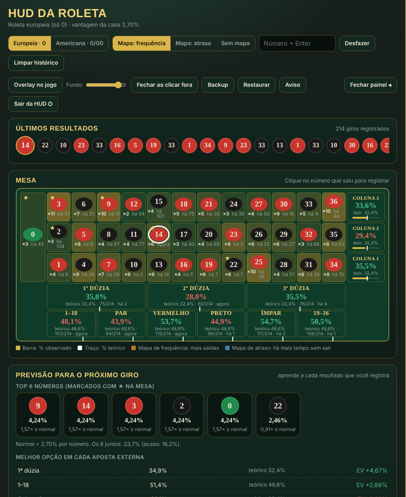

  

<h1 align="center">HUD da Roleta</h1>

  Painel e overlay para PC que registram cada giro da roleta do seu jogo, 
  testam 7 modelos estatísticos e mostram se existe padrão ou se é sorte pura.

  <a href="https://github.com/SEU-USUARIO/hud-da-roleta/releases/latest"><b>⬇ Baixar a versão mais recente</b></a>
  &nbsp;·&nbsp;
  <a href="https://discord.gg/Z7g372ErUt"><b>Comprar a chave no Discord</b></a>

---

## O que a HUD faz

- **Painel lateral e overlay por cima do jogo.** O painel abre e fecha pela esquerda da tela (Ctrl+Shift+A). O overlay compacto fica num canto e pode ser travado para os cliques passarem para o jogo.
- **Histórico e estatísticas.** Frequência e atraso de cada número, mapa de calor, sequências, dúzias, colunas e cores comparadas com o teórico.
- **Previsão que se testa sozinha.** 7 modelos competem a cada giro. O placar mostra quantos acertos cada um teve comparado ao acaso, e a validação confirma o padrão só em giros novos.
- **Detector de jogo viciado.** Mostra se o jogo evita os números em que você aposta ou se a roda anda casas demais entre um giro e outro.

Funciona com roleta europeia (só o zero) e americana (zero e duplo zero), incluindo a roleta do ROB RUN.

## Como baixar e instalar

1. Abra a página de [Releases](https://github.com/SEU-USUARIO/hud-da-roleta/releases/latest) e baixe o arquivo **HUD.da.Roleta.Setup.exe**.
2. Abra o arquivo. Se o Windows mostrar "O Windows protegeu o computador", clique em **Mais informações** e depois em **Executar assim mesmo**. O aviso aparece porque o programa é novo e ainda não tem assinatura digital.
3. Conclua a instalação e abra a HUD pelo atalho na Área de Trabalho.

Também tem a versão **Portatil**, que roda sem instalar.

**Requisitos:** Windows 10 ou 11. O jogo precisa estar em modo janela ou tela cheia sem bordas para o painel ficar por cima.

## Ativação

A HUD precisa de uma chave para funcionar. A chave é **vitalícia** e vale para **um computador**.

1. Na primeira vez que você abre a HUD, aparece o **Código deste PC**.
2. Entre no [Discord](https://discord.gg/Z7g372ErUt), faça a compra e envie esse código.
3. Você recebe a sua chave. Cole na tela de ativação e clique em **Ativar**.

Se formatar o PC ou trocar de computador, peça uma nova chave no Discord.

## Atalhos

| Atalho | O que faz |
| --- | --- |
| Ctrl+Shift+A | Abre ou fecha o painel lateral |
| Ctrl+Shift+H | Mostra ou esconde o overlay compacto |
| Ctrl+Shift+L | Trava ou destrava o overlay (cliques passam para o jogo) |
| Ctrl+Shift+Espaço | Digita o número que saiu sem sair do jogo |

## ⚠️ Aviso importante

A HUD da Roleta é uma ferramenta de estatística. **Ela não garante ganhos.** Numa roleta justa, cada giro é independente e nenhuma ferramenta muda a chance de um número sair. As sugestões só têm valor quando a validação mostra "Confirmado em dados novos"; antes disso, são palpites.

- A HUD não lê, não altera e não acessa o jogo, a memória dele nem a sua conta. Você digita os resultados.
- Não use para apostas com dinheiro real.
- Confira se os termos de uso do seu jogo permitem ferramentas externas. Você é o único responsável pelo uso.
- A HUD da Roleta é um projeto independente. Não é afiliada, patrocinada nem aprovada pela Kefir ou pelo ROB RUN. Os nomes citados pertencem aos seus donos.

## Suporte

Dúvidas e problemas: [Discord](https://discord.gg/Z7g372ErUt).
